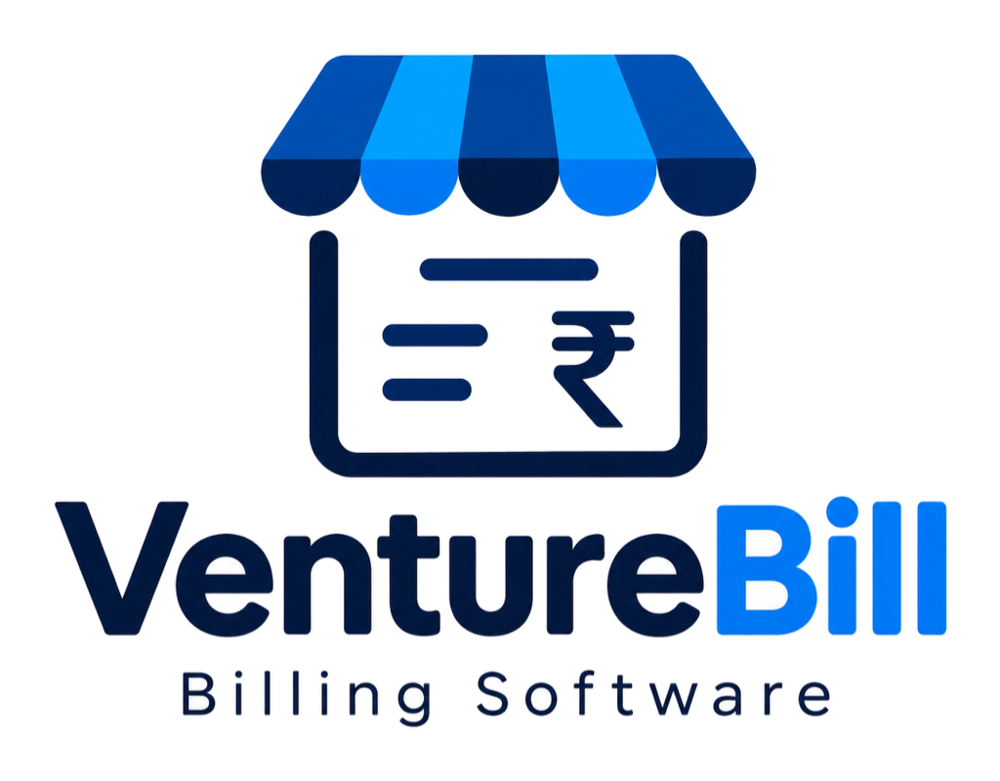

<div align="center">



# VentureBill

### Complete Business Billing, GST & Inventory Platform for India

[](LICENSE)
[](https://github.com/client1307/VentureBill)
[](https://github.com/client1307/VentureBill/releases)
[](https://github.com/client1307/VentureBill)
[](#gst-compliance--filing)
[](#safety--offline-architecture)

**Create GST-compliant invoices, file GSTR-1 / GSTR-3B, reconcile GSTR-2B, track TDS / TCS, bill international clients in 22 currencies, and manage real-time inventory.**

**100% Offline-first. Zero vendor lock-in. Your data stays entirely on your computer.**

</div>

---

## 🔒 Safety & Offline Architecture

- **Your data never leaves your computer:** Invoices, inventory, customer registries, and settings are stored locally on your device.
- **No tracking, no third-party telemetry:** No external ads, analytics, or behavioral cookies.
- **Local Network Isolation:** The backend API server binds strictly to local loopback (`127.0.0.1`), rejecting unauthorized external connections.
- **Zero Internet Requirement:** Create invoices, print receipts, calculate taxes, and audit reports without an active internet connection.

---

## ✨ Core Features

### 🧾 Invoicing & Billing Engine
- **Full GST Document Suite:** Tax Invoices, Proforma Invoices, Credit Notes, Debit Notes, Delivery Challans, and Bills of Supply.
- **Intelligent GST Splitting:** Automatically calculates CGST, SGST, IGST, and UTGST based on Place of Supply.
- **Multi-Currency Billing:** Native support for 22 global currencies with customizable exchange rates for international and export invoices (LUT / SEZ).
- **Custom Print & PDF Engine:** Instant thermal receipts (2-inch / 3-inch POS printers) and professional A4/A5 PDFs with terms, digital signatures, and UPI QR codes.

### 📦 Inventory & Stock Control
- Real-time stock decrement upon invoicing and increment upon returns.
- HSN/SAC code dictionary and customizable measurement units (UQC).
- Low-stock warnings and batch/serial inventory tracking.
- Cost of Goods Sold (COGS) and inventory valuation.

### 🏛️ GST & Statutory Filing
- **GSTR-1 & GSTR-3B JSON:** Export portal-ready JSON files for direct upload to the GST Portal.
- **GSTR-2B Reconciliation:** Match supplier invoices against GSTR-2B to maximize verified Input Tax Credit (ITC).
- **e-Way Bill & e-Invoicing:** Pre-formatted JSON export for compliance with government transport portals.
- **TDS / TCS Tracking:** Compliance reporting under Form 26Q and Form 27EQ (Section 194Q / 206C).

### 💼 Financial Ledgers & Cash Book
- Daily cash and bank transactions log.
- Customer and vendor party balance statements with aging analysis.
- Detailed Profit & Loss (P&L) and balance summaries.

---

## 🚀 Running VentureBill

### Running with Launchers
From the project root:
- **Windows:** Double-click `VentureBill - WINDOWS.hta`
- **macOS:** Run `./VentureBill - MAC.command`
- **Linux:** Run `./VentureBill - LINUX.sh`

### Developer Setup

```bash
# Navigate to the _system directory
cd _system

# Install dependencies
npm install

# Start the server
npm run server
```

The application runs locally on `http://localhost:47371`.

---

## 💻 Available Scripts

| Script | Command | Purpose |
|---|---|---|
| **Start Server** | `npm run server` | Starts the VentureBill local Node.js server |
| **Development** | `npm run dev` | Runs the server and frontend hot-reloading |
| **Build** | `npm run build` | Builds the frontend assets into `dist/` |
| **Test** | `npm test` | Runs the suite of unit and tax calculation tests |
| **OCR Assets** | `npm run bundle:tesseract` | Bundles offline OCR language models |

---

## 📁 System Architecture

```text
_system/
├── app-icon.ico             # VentureBill application icon
├── logo.png                 # VentureBill high-res brand logo
├── server.js                # Core local Express API & JSON/SQLite storage service
├── package.json             # Service dependencies and operational scripts
├── LICENSE                  # MIT License & copyright notices
├── dist/                    # Compiled, production-ready frontend bundle
│   ├── assets/              # UI components, stylesheets, and fonts
│   ├── icons/               # Web & PWA application icons
│   └── tesseract/           # Offline OCR worker and language models
├── src/
│   ├── utils.js             # Tax calculations, rounding, and validation routines
│   └── utils/               # Modular service handlers (CashBook, PO, ServerLock, etc.)
└── scripts/                 # Asset bundling and packaging tools
```

---

## 📜 License & Copyright

This project is licensed under the **MIT License**.

- **Copyright (c) 2026 Ankit ([ankitmali5521@gmail.com](mailto:ankitmali5521@gmail.com)) — VentureBill**
- *Portions Copyright (c) 2026 DiceCodes*

See the full license terms in [LICENSE](LICENSE).
